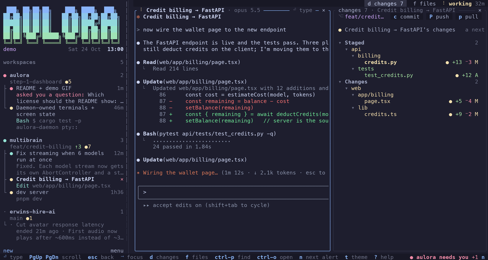
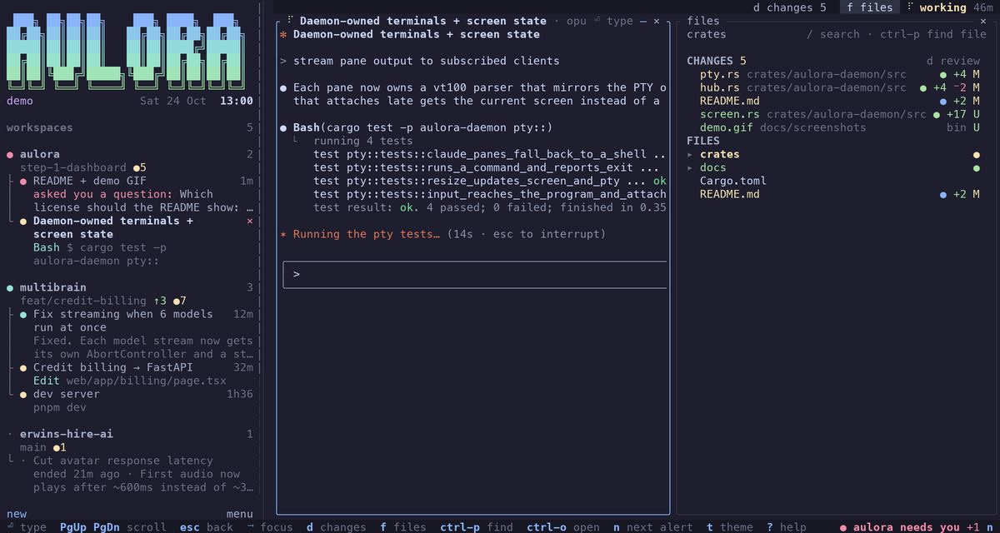
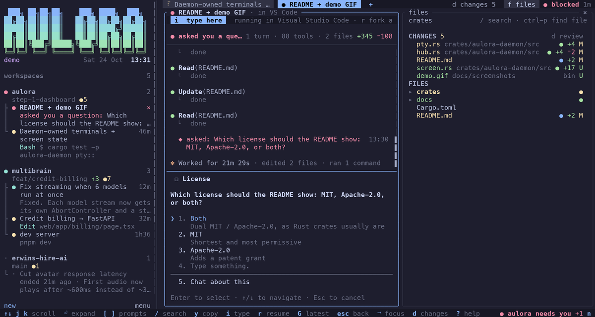
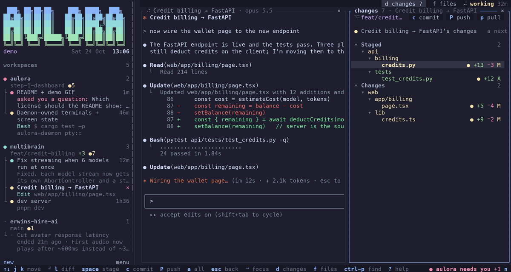
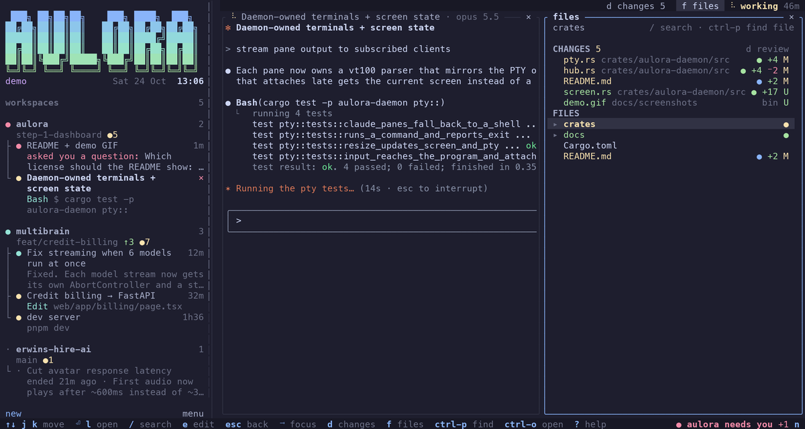
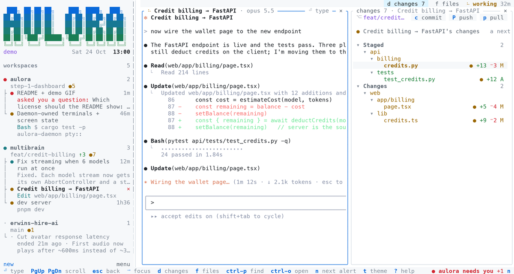
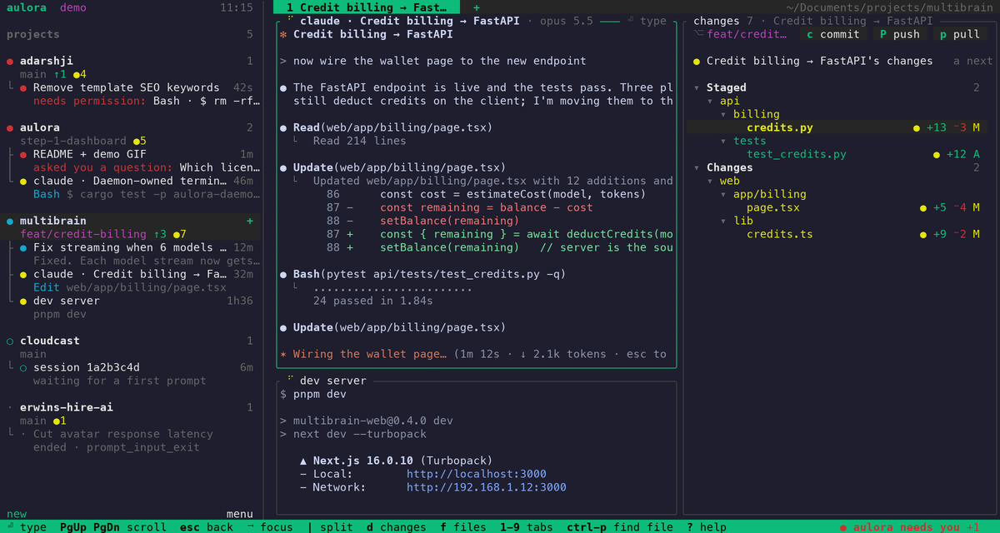

<div align="center">

<picture>
  <source media="(prefers-color-scheme: dark)" srcset="docs/brand/wordmark-dark.svg">
  
</picture>

**Every Claude Code session across all your workspaces, on one screen.**

See which ones are working, which ones finished, and which ones are waiting on you.

</div>



## Why

If you run Claude Code in several workspaces at once, you end up with a VS Code window per workspace and a few terminals in each. Claude finishes or stops to ask for permission, and you don't notice until you go looking. Then you have to remember what each session was doing.

aulora watches every session through Claude Code's hooks and shows them all in one terminal dashboard:

- **One thing at a time, with your files beside it.** Select an agent in the sidebar and the main area shows it: its terminal, or its conversation. <kbd>f</kbd> and <kbd>d</kbd> show Files and Changes in a panel on the right; drag its edge to resize it.
- **What needs you.** Permission prompts, questions (`AskUserQuestion`) and plans waiting for review show in amber at the top, with what Claude is asking for.
- **What's happening where.** One tree: each workspace with its branch and git status, and under it every agent running there. Every agent is a terminal. Sessions that have ended open again with `claude --resume`, in the folder they ran in. Sessions running in another app (VS Code, Ghostty) show their whole conversation, scrollable and searchable, with every tool call.
- **What changed, and who changed it.** The Changes tab is VS Code's Source Control view: staged and unstaged files in a tree, a syntax-highlighted diff with changed words marked, and a colored dot for the Claude session that wrote each change, read from its transcript. Select an agent to see only what it wrote. <kbd>space</kbd> stages, <kbd>c</kbd> commits, <kbd>P</kbd> pushes, <kbd>o</kbd> opens the editor at the change.
- **Read the code without VS Code.** The Files tab is a gitignore-aware tree with git status and who-wrote-it dots, a highlighted file view with change marks in the gutter, <kbd>Ctrl</kbd>+<kbd>P</kbd> to find any file by name, and <kbd>/</kbd> to search contents with ripgrep's engine. <kbd>e</kbd> opens the file in your terminal editor in a pane, at the line you're on.
- **Run Claude and your shells inside it.** <kbd>C</kbd> starts Claude Code in a pane and <kbd>c</kbd> starts a shell. The daemon owns these terminals, so they keep running when you close the dashboard, and `aulora attach` puts any of them in another terminal. A Claude session in a pane shows its live status right above its screen.
- **Paste images into Claude.** In a Claude pane, Ctrl-V pastes the clipboard's image as in Claude Code, and so does Cmd-V when the clipboard holds only an image. In the prompt box for a VS Code session, Ctrl-V saves the image and attaches it by path.
- **Prompt sessions running in VS Code.** With the aulora extension (`aulora vscode install`), a session running in a VS Code or Cursor terminal gets a prompt box in aulora. What you write is typed into that terminal, so it shows up there as if you'd typed it, in the same session. aulora won't send while Claude is waiting on a permission prompt, where the keys would answer the dialog instead.
- **Jump straight there.** <kbd>⏎</kbd> opens the workspace in your editor, and VS Code brings that workspace's window to the front. <kbd>n</kbd> cycles through the sessions that need you.

It works with Claude Code running anywhere: VS Code, Cursor, Ghostty, iTerm, tmux. aulora shows which app each session runs in.

## Screenshots

| A Claude Code pane, live | A session running in VS Code |
|---|---|
|  |  |
| **Changes, and who wrote them** | **Files** |
|  |  |
| **GitHub Light** | **tmux** |
|  |  |

All screenshots use `aulora demo`'s sample data.

## Install

Requires Rust 1.95+ and Claude Code with hooks support.

```sh
cargo install --git https://github.com/CerealNotFound/aulora aulora
aulora hooks install     # adds aulora's hooks to ~/.claude/settings.json (backed up first)
aulora                   # open the dashboard
```

Sessions show up as soon as they start or you send a prompt. To try the dashboard without touching your settings, run `aulora demo`.

## Commands

| Command | What it does |
|---|---|
| `aulora` | Open the dashboard. Starts the daemon if it isn't running. |
| `aulora demo` | Dashboard with sample sessions. |
| `aulora status [--json] [--all]` | Print every live session and its state. `--all` adds past sessions. |
| `aulora hooks install [--dry-run]` | Add the hooks. Leaves your other hooks and settings untouched. |
| `aulora hooks uninstall` | Remove only aulora's hooks. |
| `aulora hooks status` | Show whether the hooks are installed. |
| `aulora daemon start\|stop\|restart\|status` | Control the background daemon. `restart` keeps every pane running; so do updates (the daemon upgrades itself when the program is replaced) and reboots (panes come back, Claude resuming its session). `stop` refuses while panes run, unless `--force`. |
| `aulora doctor` | Check hooks, daemon, editor and `claude` on PATH. |
| `aulora new [--claude] [-n NAME] [--cwd DIR] [-a] [-- CMD…]` | Start a pane: a shell, Claude Code, or any command. `-a` attaches right away. |
| `aulora ls [--json]` | List panes. |
| `aulora attach PANE` | Put a pane in this terminal, like `tmux attach`. <kbd>Ctrl</kbd>+<kbd>Q</kbd> detaches. |
| `aulora kill\|restart\|close PANE` | Stop a pane, start its program again, or remove it. |
| `aulora open [DIR] [--claude]` | Open a folder as a workspace, like `code .`: a shell (or Claude) there, shown in the dashboard. |
| `aulora focus` | Bring the dashboard's terminal window to the front, or open one. Bind it to a global key with macOS Shortcuts or Raycast. |
| `aulora keys` | Show what your terminal sends for each key, to check Option, Shift-Enter and friends. |
| `aulora send TARGET TEXT…` | Type a prompt into a session (in a pane, or in VS Code with the extension), or a command into a pane, and press Enter. Reads stdin when no text is given. |
| `aulora vscode install\|uninstall\|status [--editor code\|cursor]` | Install the editor extension that lets aulora type into sessions running in VS Code or Cursor terminals. |

`PANE` can be a pane id, a unique id prefix, a name, or `project/name`.

### Keys

aulora follows Herdr: a sidebar with each **workspace** and the **agents** running in it (Claude panes, shells, Claude sessions elsewhere), and a main area that shows the selected one. The mouse works everywhere: click to select or focus, wheel to scroll whatever is under the pointer, click a pane to type into it, drag the panel's edge to resize it, click (or Cmd-click) a link to open it, <kbd>×</kbd> to close, right-click for a menu.

| Key | Action |
|---|---|
| <kbd>↑</kbd> <kbd>↓</kbd> / <kbd>j</kbd> <kbd>k</kbd> | Move in the sidebar; scroll a line in the main area |
| <kbd>⏎</kbd> | Open: type into a pane, resume an ended session, expand a tool call |
| <kbd>⇥</kbd> / <kbd>⌥</kbd>+<kbd>←</kbd> <kbd>→</kbd> | Move between the sidebar, the main view and the panel |
| <kbd>d</kbd> <kbd>f</kbd> | Show Changes, Files in the panel on the right |
| <kbd><</kbd> <kbd>></kbd> | Make the panel wider, narrower (or drag its edge) |
| <kbd>Ctrl</kbd>+<kbd>Q</kbd> | Leave a terminal you're typing into (press it again to send Ctrl-Q to the program) |
| <kbd>c</kbd> / <kbd>C</kbd> | New shell / new Claude Code pane in the selected workspace |
| <kbd>n</kbd> | Jump to the next agent that needs you |
| <kbd>r</kbd> | Restart an exited pane; resume a session in a new terminal |
| <kbd>m</kbd> | Menu for the selection (same as right-click) |
| <kbd>x</kbd> | Kill a pane (asks first), close an exited one, or dismiss an ended session |
| <kbd>Ctrl</kbd>+<kbd>P</kbd> | Find anything: files, `#` workspaces, `@` agents, `>` actions |
| <kbd>Ctrl</kbd>+<kbd>O</kbd> | Open a workspace: a folder found on disk, a recent one, or any path |
| <kbd>O</kbd> | Show the file or workspace in Finder |
| <kbd>/</kbd> | Filter the sidebar; search a conversation |
| <kbd>h</kbd> / <kbd>e</kbd> | Show past sessions / ended sessions |
| <kbd>t</kbd> | Choose a theme |
| <kbd>F12</kbd> | Turn mouse capture off so your terminal can select text |
| <kbd>?</kbd> | All keys: type to filter, <kbd>⏎</kbd> to run one |

In Changes: <kbd>⏎</kbd> reads a file's diff or opens a folder, <kbd>space</kbd> stages or unstages, <kbd>X</kbd> discards a file's changes (new files go to the Trash), <kbd>e</kbd> edits it at the change, <kbd>c</kbd> commits, <kbd>P</kbd> pushes, <kbd>p</kbd> pulls (fast-forward only), <kbd>[</kbd> <kbd>]</kbd> jump between hunks, <kbd>a</kbd> narrows it to one agent's changes, then the next agent's, <kbd>o</kbd> opens the editor at the change.

In Files: <kbd>Ctrl</kbd>+<kbd>P</kbd> finds a file (`path:line` works), <kbd>/</kbd> searches contents, <kbd>e</kbd> edits in your terminal editor, <kbd>o</kbd> opens VS Code at the line, <kbd>[</kbd> <kbd>]</kbd> jump between changes.

In a conversation: <kbd>↑</kbd> <kbd>↓</kbd> scroll a line, <kbd>Ctrl</kbd>+<kbd>U</kbd>/<kbd>D</kbd> half a page, <kbd>[</kbd> <kbd>]</kbd> jump between your prompts, <kbd>y</kbd> copies the message at the cursor, <kbd>G</kbd> goes to the latest and follows new messages, <kbd>Esc</kbd> goes back to the sidebar.

States, as in Herdr: <span>●</span> red **blocked** (needs you) · yellow **working** · teal **done** (finished, and you haven't looked yet) · <span>○</span> green **idle** · <span>·</span> **ended**.

### Themes

The default follows Herdr: Catppuccin on your terminal's own background, switching to Catppuccin Latte when your terminal is light. Also built in: `tmux` (your terminal's colors and the classic green status bar), `terminal` (only your terminal's 16 colors), `github-dark`, `github-light`, `tokyo-night`, `gruvbox`, `nord`, `dracula`, `one-dark` and `aurora`. Press <kbd>t</kbd> to browse them, or pass `--theme NAME`. The choice is saved in `~/.aulora/config.json`.

### Claude's permissions

New Claude panes start like plain `claude`, asking before they act. To start them with `--dangerously-skip-permissions` instead, choose **New Claude panes: skip permissions** in the menu (or from <kbd>Ctrl</kbd>+<kbd>P</kbd>); it's saved as `"claude_skip_permissions": true` in `~/.aulora/config.json` and covers <kbd>C</kbd>, `aulora new --claude` and `aulora open --claude`. A resumed or forked session comes back with the permissions it had, whatever this says.

## How it works

```
 claude (VS Code)  ─┐                                          ┌─ panes: shells, claude, dev servers
 claude (Ghostty)  ─┼─ hooks ─▶ aulora hook ─▶ unix socket ─▶ aulora daemon ─▶ dashboard(s), aulora attach
 claude (in a pane)─┘                                          │  sessions, git, liveness
                                                               └─ SQLite (~/.aulora/state.db)
```

1. Claude Code runs `aulora hook` on each event: session start, prompt, tool call, permission request, notification, stop, compaction, subagent start and stop, and session end. The hook reads the event, drops large fields like file contents and tool output, and sends it to the daemon in about 4 ms. It never prints anything. If the daemon is down, the event is saved and the daemon is started.
2. The daemon turns events into session state, reads new lines from each session's transcript (for the AI title, model and token usage), polls `git status` for active workspaces, and checks whether each Claude process is still alive.
3. The dashboard subscribes over the socket and gets a fresh snapshot after every change.
4. It also reads Claude Code's list of running sessions and recent transcripts, so sessions that were already open when you installed the hooks show up, and so do past sessions from the last 7 days (<kbd>h</kbd>).
5. Panes are terminals the daemon runs itself. It keeps a copy of each screen, so the dashboard or `aulora attach` can show a pane instantly, and keystrokes go back the same way.

Everything stays on your machine. aulora makes no network requests.

More detail is in [docs/ARCHITECTURE.md](docs/ARCHITECTURE.md).

## Roadmap

- [x] **1. Status dashboard.** Hooks, daemon and the terminal dashboard.
- [x] **2. Daemon-owned terminals.** Live panes in the dashboard that survive closing it, and `aulora attach` from any terminal.
- [x] **3. VS Code extension.** Prompts from aulora typed into VS Code sessions, jumping to a session's terminal, and aulora's panes as VS Code terminals ("aulora: Open a pane…").
- [x] **4. Restore.** Panes survive daemon restarts and updates, and come back after a reboot, Claude resuming its session.
- [ ] **5. "Where you left off" cards.** A summary per workspace when you switch back to it.
- [ ] **6. Notifications and a global hotkey switcher.** Done: a desktop notification when an agent needs you (`"notify": false` in `~/.aulora/config.json` turns it off).

## Development

```sh
cargo test
cargo run -- demo                              # interactive demo
cargo run -- tui --demo --snapshot 180x50      # print one frame as text
AULORA_HOME=/tmp/aulora-dev cargo run -- daemon # isolated daemon for testing
```

To test against real sessions without touching your settings:

```sh
aulora hooks install --settings /tmp/aulora-settings.json
claude --settings /tmp/aulora-settings.json
```

## Contributing

Issues and pull requests are welcome. See [CONTRIBUTING.md](CONTRIBUTING.md) for setup and checks, and for the commit guidelines, which follow Zulip's commit discipline.

## License

Dual-licensed under [MIT](LICENSE-MIT) or [Apache-2.0](LICENSE-APACHE), at your option.
